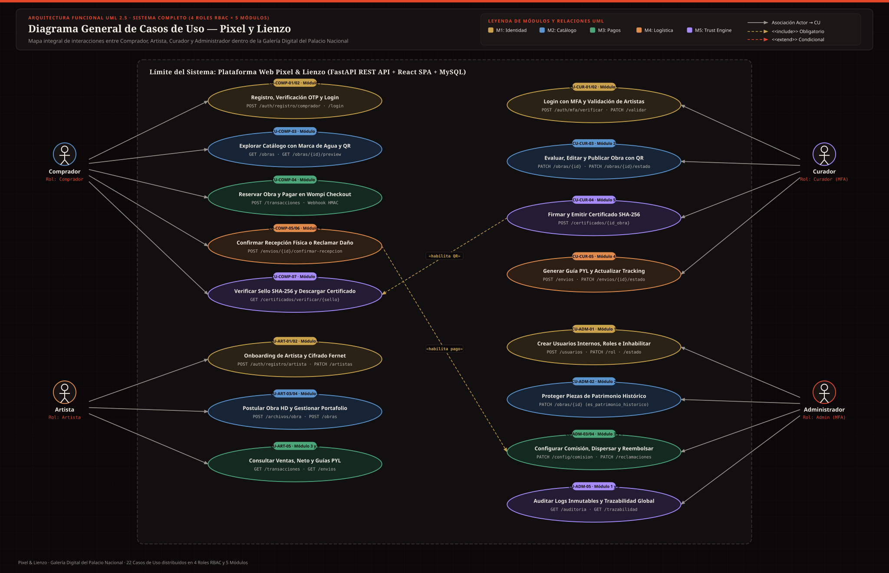
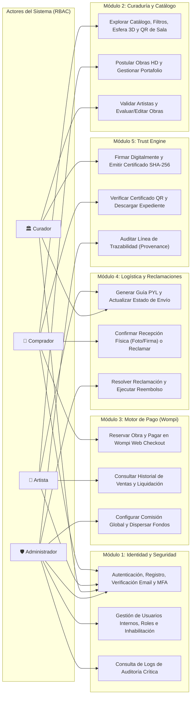

# 📋 Especificación General de Casos de Uso — Pixel & Lienzo

Este directorio contiene la especificación técnica y funcional completa de los **Casos de Uso (CU)** del sistema **Pixel & Lienzo — Galería Digital del Palacio Nacional**, organizados por los **4 roles oficiales** definidos en el modelo de Control de Acceso Basado en Roles (**RBAC**, tabla `rol`):

1. **[01 — Rol Comprador](./01_Casos_de_Uso_Comprador.md)** (`id_rol = 4`)
2. **[02 — Rol Artista](./02_Casos_de_Uso_Artista.md)** (`id_rol = 3`)
3. **[03 — Rol Curador](./03_Casos_de_Uso_Curador.md)** (`id_rol = 2`)
4. **[04 — Rol Administrador](./04_Casos_de_Uso_Administrador.md)** (`id_rol = 1`)

---

## 🗺️ Diagrama Visual UML General de Casos de Uso (SVG)

### Diagramas Visuales por Rol (Archivos SVG de Alta Resolución)
- 🖼️ **[`Diagrama_00_General_Casos_de_Uso.svg`](./Diagrama_00_General_Casos_de_Uso.svg)** — Vista general de los 4 Roles RBAC y los 5 Módulos
- 👤 **[`Diagrama_01_Casos_de_Uso_Comprador.svg`](./Diagrama_01_Casos_de_Uso_Comprador.svg)** — Diagrama UML del Rol Comprador
- 🎨 **[`Diagrama_02_Casos_de_Uso_Artista.svg`](./Diagrama_02_Casos_de_Uso_Artista.svg)** — Diagrama UML del Rol Artista
- 🏛️ **[`Diagrama_03_Casos_de_Uso_Curador.svg`](./Diagrama_03_Casos_de_Uso_Curador.svg)** — Diagrama UML del Rol Curador
- 🛡️ **[`Diagrama_04_Casos_de_Uso_Administrador.svg`](./Diagrama_04_Casos_de_Uso_Administrador.svg)** — Diagrama UML del Rol Administrador

---

## 🗺️ Diagrama Interactivo por Módulos (Mermaid)

---

## 📊 Matriz Resumen de Casos de Uso por Rol

| Código CU | Nombre del Caso de Uso | Rol Principal | Módulo | Requisitos (`RF`) | Endpoint Principal (`/api/v1`) |
| :--- | :--- | :--- | :--- | :--- | :--- |
| **CU-COMP-01** | Registro de Comprador y Verificación de Correo | Comprador | Módulo 1 | RF 1.1.1, 1.1.2, 1.1.6, 1.1.7 | `POST /auth/registro/comprador`, `POST /auth/verificar-email` |
| **CU-COMP-02** | Inicio de Sesión, Refresh y Recuperación de Contraseña | Comprador | Módulo 1 | RF 1.4.1, 1.4.3, 1.4.4 | `POST /auth/login`, `POST /auth/password/recuperar` |
| **CU-COMP-03** | Exploración de Catálogo con Marca de Agua y Escaneo QR | Comprador | Módulo 2 | RF 1.3.5, 2.1.2, 2.3.1 | `GET /obras`, `GET /obras/{id}/preview`, `GET /obras/uid/{uid}` |
| **CU-COMP-04** | Reserva Concurrente de Obra y Pago en Wompi Checkout | Comprador | Módulo 3 | RF 2.4.2, 3.1.1–3.1.3, 3.3.1 | `POST /transacciones`, `POST /transacciones/webhook/wompi` |
| **CU-COMP-05** | Seguimiento de Envío y Confirmación de Recepción Física | Comprador | Módulo 4 | RF 4.3.2, 4.4.1, 4.4.2 | `GET /envios`, `POST /envios/{id}/confirmar-recepcion` |
| **CU-COMP-06** | Registro de Reclamación por Daños en Transporte | Comprador | Módulo 4 | RF 4.5.1 | `POST /reclamaciones` |
| **CU-COMP-07** | Verificación Pública y Descarga de Certificado SHA-256 | Comprador | Módulo 5 | RF 5.2.2, 5.3.1, 5.3.2 | `GET /certificados/verificar/{sello}`, `GET /certificados/{id}/descargar` |
| **CU-ART-01** | Onboarding de Artista con Cifrado Bancario y Documento | Artista | Módulo 1 | RF 1.1.3, 1.1.4 | `POST /archivos/documento-identidad`, `POST /auth/registro/artista` |
| **CU-ART-02** | Actualización de Biografía y Cuenta Bancaria Cifrada | Artista | Módulo 1 | RF 1.2.6, 1.3.4 | `PATCH /artistas/{id_artista}` |
| **CU-ART-03** | Ingesta de Obra de Arte en Alta Resolución | Artista | Módulo 2 | RF 1.2.4, 2.1.1–2.1.4 | `POST /archivos/obra`, `POST /obras` |
| **CU-ART-04** | Gestión y Corrección de Obras en Estado Pendiente | Artista | Módulo 2 | RF 1.3.4, 2.2.3 | `GET /obras/mis-obras`, `PATCH /obras/{id_obra}` |
| **CU-ART-05** | Consulta de Ventas, Liquidación Neta y Guías de Despacho | Artista | Módulo 3 y 4 | RF 3.4.3, 3.5.3, 4.2.1 | `GET /transacciones`, `GET /envios` |
| **CU-CUR-01** | Autenticación con Doble Factor Obligatorio (MFA) | Curador | Módulo 1 | RF 1.4.2 | `POST /auth/login`, `POST /auth/mfa/verificar` |
| **CU-CUR-02** | Auditoría y Validación de Perfiles de Artistas | Curador | Módulo 1 | RF 1.2.1–1.2.3, 1.3.3 | `GET /artistas/pendientes`, `PATCH /artistas/{id}/validar` |
| **CU-CUR-03** | Evaluación Curatorial, Edición Técnica y Publicación de Obra | Curador | Módulo 2 | RF 2.2.1–2.2.4, 2.3.1, 2.4.4 | `GET /obras/pendientes`, `PATCH /obras/{id}`, `PATCH /obras/{id}/estado` |
| **CU-CUR-04** | Emisión de Certificado con Firma Digital y Sello SHA-256 | Curador | Módulo 5 | RF 5.1.1, 5.1.2, 5.2.1 | `GET /certificados/pendientes`, `POST /certificados/{id_obra}` |
| **CU-CUR-05** | Gestión de Despacho Logístico y Generación de Guía PYL | Curador | Módulo 4 | RF 4.1.3, 4.2.3, 4.3.1 | `POST /envios`, `PATCH /envios/{id}/estado` |
| **CU-ADM-01** | Creación de Usuarios Internos, Cambio de Rol e Inhabilitación | Administrador | Módulo 1 | RF 1.1.5, 1.3.1, 1.3.7 | `POST /usuarios`, `PATCH /usuarios/{id}/rol`, `PATCH /usuarios/{id}/estado` |
| **CU-ADM-02** | Catalogación de Piezas de Patrimonio Histórico | Administrador | Módulo 2 | RF 2.4.1 | `PATCH /obras/{id_obra}` (`es_patrimonio_historico`) |
| **CU-ADM-03** | Configuración de Comisión de Galería y Dispersión al Artista | Administrador | Módulo 3 | RF 1.3.2, 3.2.1, 3.5.1, 3.5.2 | `PATCH /transacciones/config/comision`, `PATCH /transacciones/{id}/estado` |
| **CU-ADM-04** | Resolución de Reclamaciones y Reembolso Automático | Administrador | Módulo 4 | RF 3.3.3, 4.5.2 | `GET /reclamaciones`, `PATCH /reclamaciones/{id}/estado` |
| **CU-ADM-05** | Auditoría de Seguridad y Trazabilidad Global (*Provenance*) | Administrador | Módulo 1 y 5 | RF 1.4.5, 1.5.1–1.5.3, 5.4.2 | `GET /auditoria`, `GET /trazabilidad` |

