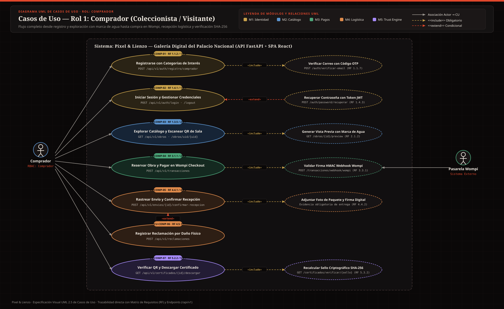
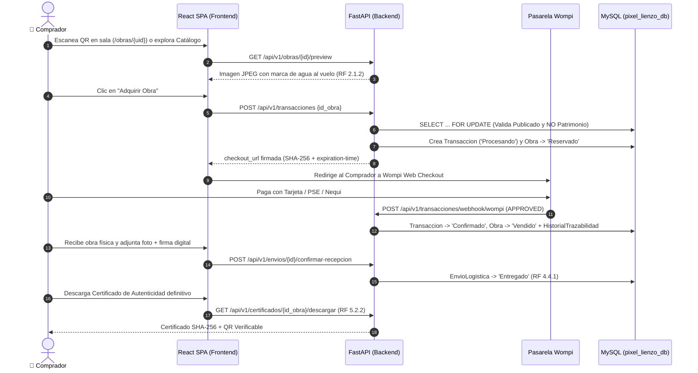

# 👤 Casos de Uso — Rol 1: Comprador (`Comprador`)

El **Comprador** es el visitante o coleccionista que explora la galería digital, escanea códigos QR en sala, adquiere obras originales mediante la pasarela de pago **Wompi**, realiza el seguimiento de su envío, confirma la recepción física de la pieza y descarga su Certificado de Autenticidad verificable.

---

## 🖼️ Diagrama UML de Casos de Uso — Rol Comprador (SVG)

---

## 🔄 Diagrama de Secuencia del Flujo Principal del Comprador (Exploración → Compra Wompi → Recepción → Certificado)

---

## CU-COMP-01: Registro de Comprador y Verificación de Correo
- **Actor Principal:** Comprador
- **Requisitos Asociados:** `RF 1.1.1`, `RF 1.1.2`, `RF 1.1.6`, `RF 1.1.7`
- **Endpoints y Tablas:** `POST /api/v1/auth/registro/comprador`, `POST /api/v1/auth/verificar-email` | Tablas: `usuario`, `rol`, `preferencia_comprador`, `categoria_arte`
- **Precondiciones:** El correo electrónico no debe estar registrado previamente en la tabla `usuario`.
- **Flujo Principal:**
  1. El usuario selecciona el flujo de registro como **Comprador** en `/registro/comprador`.
  2. Ingresa su correo electrónico, contraseña y selecciona sus categorías artísticas de interés (`categorias_interes`).
  3. El sistema valida la unicidad del correo, aplica hash `bcrypt` a la contraseña, asigna el rol `Comprador` y guarda las preferencias en `preferencia_comprador`.
  4. El sistema genera un código OTP temporal (`otp_service`) y lo envía al correo del comprador.
  5. El comprador ingresa el código en `/verificar-email` (`POST /auth/verificar-email`) y confirma su dirección.
- **Flujo Alternativo / Excepciones:**
  - *409 Conflict:* Si el correo ya existe, el sistema rechaza el registro e informa al usuario.
  - *400 Bad Request:* Si el código OTP expiró o es incorrecto, solicita un nuevo intento.
- **Postcondiciones:** Cuenta de comprador activa con preferencias registradas y correo validado.

---

## CU-COMP-02: Inicio de Sesión, Cierre de Sesión y Recuperación de Contraseña
- **Actor Principal:** Comprador
- **Requisitos Asociados:** `RF 1.4.1`, `RF 1.4.3`, `RF 1.4.4`
- **Endpoints y Tablas:** `POST /api/v1/auth/login`, `POST /api/v1/auth/logout`, `POST /api/v1/auth/password/recuperar`, `POST /api/v1/auth/password/restablecer` | Tablas: `usuario`, `log_auditoria`
- **Precondiciones:** El comprador debe poseer una cuenta con `estado_cuenta = 'Activo'`.
- **Flujo Principal:**
  1. El comprador ingresa su correo y contraseña en `/login`.
  2. El sistema verifica el hash de la contraseña y emite el par `access_token` y `refresh_token` (JWT).
  3. Cuando el comprador cierra sesión (`POST /auth/logout`), el sistema revoca inmediatamente el `jti` del token en memoria para impedir su reutilización.
- **Flujo Alternativo (Olvido de contraseña):**
  1. El comprador solicita recuperación en `/recuperar-password` (`POST /auth/password/recuperar`).
  2. El sistema envía un enlace con un JWT de propósito único (`password_reset`) que expira en 30 minutos.
  3. El comprador establece su nueva contraseña en `/restablecer-password` y el token queda revocado.
- **Postcondiciones:** Sesión autenticada o cerrada de forma segura; intentos fallidos quedan registrados en `log_auditoria` (`LOGIN_FALLIDO`).

---

## CU-COMP-03: Exploración de Catálogo con Marca de Agua y Escaneo de QR en Sala
- **Actor Principal:** Comprador / Visitante
- **Requisitos Asociados:** `RF 1.3.5`, `RF 2.1.2`, `RF 2.3.1`, `RF 2.4.1`
- **Endpoints y Tablas:** `GET /api/v1/obras`, `GET /api/v1/obras/{id}/preview`, `GET /api/v1/obras/uid/{uid}`, `GET /api/v1/obras/{id}` | Tablas: `obra_arte`, `categoria_arte`, `perfil_artista`
- **Precondiciones:** Las obras deben encontrarse en `estado_obra = 'Publicado'`.
- **Flujo Principal:**
  1. El comprador accede al catálogo (`/`) o escanea con su móvil el código QR físico ubicado junto a la obra en el Palacio Nacional (`/obras/{uid}`).
  2. Puede filtrar por categoría (`id_categoria`), artista (`id_artista`) o rango de precios (`precio_min`, `precio_max`).
  3. Para cada obra, el sistema sirve la imagen a través de `GET /obras/{id}/preview`, aplicando al vuelo una marca de agua diagonal (`PIXEL Y LIENZO — VISTA PREVIA`) sin exponer el archivo original en alta resolución.
  4. Al abrir el detalle de la obra (`/obras/:idObra`), el comprador visualiza la ficha técnica completa, la línea de trazabilidad (`GET /trazabilidad/{id_obra}`) y si se trata de una obra comercializable o de **Patrimonio Histórico**.
- **Postcondiciones:** Visualización protegida del catálogo y de la ficha técnica oficial en máximo 2 interacciones desde el escaneo QR.

---

## CU-COMP-04: Reserva Concurrente de Obra y Pago en Wompi Web Checkout
- **Actor Principal:** Comprador
- **Requisitos Asociados:** `RF 2.4.1`, `RF 2.4.2`, `RF 2.4.3`, `RF 3.1.1`–`3.1.4`, `RF 3.2.2`, `RF 3.3.1`, `RF 5.4.1`
- **Endpoints y Tablas:** `POST /api/v1/transacciones`, `GET /api/v1/transacciones/{id}/checkout-wompi`, `POST /api/v1/transacciones/webhook/wompi` | Tablas: `transaccion`, `obra_arte`, `configuracion_sistema`, `historial_trazabilidad`
- **Precondiciones:** Usuario autenticado con rol `Comprador`; obra en `estado_obra = 'Publicado'` y `es_patrimonio_historico = False`.
- **Flujo Principal:**
  1. El comprador pulsa **"Adquirir obra"** en la ficha de la pieza.
  2. El backend libera primero cualquier reserva vencida (`> 30 min`), aplica bloqueo pesimista de fila (`SELECT ... FOR UPDATE`) sobre la obra, verifica que esté `Publicado` y que no sea `Patrimonio Histórico`.
  3. Calcula automáticamente la comisión de galería (`configuracion_sistema`) y el monto neto del artista (*Split Payment*), crea la `Transaccion` en estado `'Procesando'` y cambia la obra a `'Reservado'`.
  4. Genera la URL firmada de **Wompi Web Checkout** (incluyendo `signature:integrity` y `expiration-time`) y redirige el navegador del comprador a Wompi.
  5. El comprador realiza el pago (Tarjeta, PSE, Nequi). Wompi envía el evento firmado a `POST /transacciones/webhook/wompi`.
  6. El backend verifica la firma HMAC SHA-256 y el monto en centavos; al ser `APPROVED`, pasa la transacción a `'Confirmado'`, la obra a `'Vendido'`, registra el nuevo dueño en `historial_trazabilidad` y notifica por correo al artista.
- **Flujo Alternativo / Excepciones:**
  - *409 Conflict (Obra Patrimonial o ya reservada):* Si otro comprador reservó la pieza milisegundos antes o es patrimonio histórico, el sistema bloquea la venta.
  - *Pago rechazado (`DECLINED` / `VOIDED` / `ERROR`) o reserva expirada:* La transacción pasa a `'Rechazado'` y la obra vuelve automáticamente a `'Publicado'`.
- **Postcondiciones:** Obra vendida sin posibilidad de doble cobro y cambio de titularidad registrado en el historial de *Provenance*.

---

## CU-COMP-05: Seguimiento de Envío y Confirmación de Recepción Física
- **Actor Principal:** Comprador
- **Requisitos Asociados:** `RF 4.3.2`, `RF 4.4.1`, `RF 4.4.2`, `RF 4.4.3`
- **Endpoints y Tablas:** `GET /api/v1/envios`, `POST /api/v1/envios/{id_envio}/confirmar-recepcion` | Tablas: `envio_logistica`, `transaccion`
- **Precondiciones:** Compra con `estado_pago = 'Confirmado'` y guía de envío generada (`PYL-XXXXXXXXXX`).
- **Flujo Principal:**
  1. El comprador consulta el estado de su envío (`Empacado`, `En Camino`, `En Centro de Distribución`) y su número de guía en `/mis-compras`.
  2. Al recibir físicamente la obra, sube la fotografía de evidencia del paquete recibido (`foto_recepcion_url`) y/o su firma digital (`firma_digital_comprador`) mediante `POST /envios/{id_envio}/confirmar-recepcion`.
  3. El sistema actualiza `estado_envio = 'Entregado'`, habilitando la descarga del Certificado de Autenticidad definitivo y permitiendo al Administrador dispersar el pago al artista.
- **Postcondiciones:** Envío cerrado satisfactoriamente con evidencia de entrega almacenada.

---

## CU-COMP-06: Registro de Reclamación por Daños en Transporte
- **Actor Principal:** Comprador
- **Requisitos Asociados:** `RF 4.5.1`
- **Endpoints y Tablas:** `POST /api/v1/reclamaciones`, `GET /api/v1/reclamaciones/{id}` | Tablas: `reclamacion`, `envio_logistica`
- **Precondiciones:** El comprador debe ser el titular de la transacción asociada al envío y no debe existir una reclamación previa sobre el mismo envío.
- **Flujo Principal:**
  1. Si la obra llega con daños físicos, el comprador abre una reclamación formal adjuntando la descripción del daño (`descripcion_dano`) y la URL de las fotografías de evidencia (`evidencias_fotos_url`).
  2. El sistema registra la reclamación en estado `'Abierta'` y cambia automáticamente el estado del envío a `'En Reclamación'`.
- **Postcondiciones:** Caso escalado a la bandeja del Administrador para activación de póliza o reembolso.

---

## CU-COMP-07: Verificación Pública y Descarga de Certificado de Autenticidad SHA-256
- **Actor Principal:** Comprador / Tercero verificador
- **Requisitos Asociados:** `RF 5.2.2`, `RF 5.3.1`, `RF 5.3.2`
- **Endpoints y Tablas:** `GET /api/v1/certificados/verificar/{sello}`, `GET /api/v1/certificados/{id_obra}/descargar`, `GET /api/v1/certificados/{id_obra}/qr` | Tablas: `certificado_autenticidad`, `obra_arte`, `envio_logistica`
- **Precondiciones:** La obra debe contar con certificado emitido por el Curador. Para la descarga definitiva del comprador (`RF 5.2.2`), el envío debe estar en estado `'Entregado'`.
- **Flujo Principal:**
  1. Cualquier persona escanea el QR del certificado (`/verificar/{sello}`). El sistema recalcula en tiempo real el hash **SHA-256** combinando la ficha técnica actual de la obra y la firma del curador, mostrando el indicador verde (**Auténtico**) si coincide o rojo si hubo alteración.
  2. Una vez confirmada la recepción física de la obra (`estado_envio = 'Entregado'`), el comprador descarga su certificado definitivo mediante `GET /certificados/{id_obra}/descargar`.
- **Postcondiciones:** Autenticidad verificada criptográficamente y certificado entregado al nuevo propietario.

