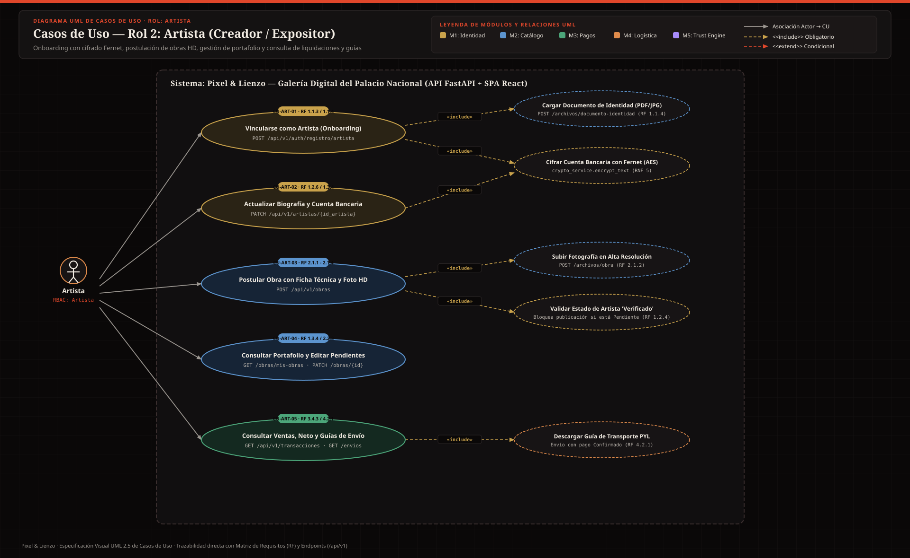
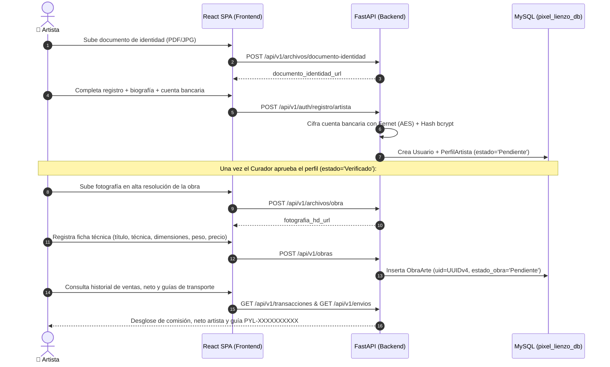

# 🎨 Casos de Uso — Rol 2: Artista (`Artista`)

El **Artista** es el creador que se vincula a la Galería Digital del Palacio Nacional, registra su documentación e información bancaria protegida con cifrado simétrico (**Fernet**), postula sus obras en alta resolución para evaluación curatorial y hace seguimiento de sus ventas, liquidaciones y guías de despacho.

---

## 🖼️ Diagrama UML de Casos de Uso — Rol Artista (SVG)

---

## 🔄 Diagrama de Secuencia del Flujo Principal del Artista (Onboarding Fernet → Postulación HD → Liquidación)

---

## CU-ART-01: Onboarding de Artista con Cifrado Bancario y Documento de Identidad
- **Actor Principal:** Artista aspirante
- **Requisitos Asociados:** `RF 1.1.1`, `RF 1.1.3`, `RF 1.1.4`, `RF 1.1.7`
- **Endpoints y Tablas:** `POST /api/v1/archivos/documento-identidad`, `POST /api/v1/auth/registro/artista`, `POST /api/v1/auth/verificar-email` | Tablas: `usuario`, `perfil_artista`
- **Precondiciones:** El correo electrónico no debe estar registrado en el sistema.
- **Flujo Principal:**
  1. El artista accede a `/registro/artista` y carga su documento de identidad (imagen o PDF, máx. 10 MB) mediante `POST /archivos/documento-identidad`, obteniendo su `documento_identidad_url`.
  2. Completa su correo, contraseña, biografía profesional e información bancaria para dispersión de pagos.
  3. El sistema aplica hash `bcrypt` a la contraseña, **cifra la información bancaria con Fernet (`crypto_service.encrypt_text`)** antes de guardarla en base de datos, y crea el `PerfilArtista` con `estado_validacion = 'Pendiente'`.
  4. Envía el código OTP de verificación de correo (`RF 1.1.7`).
- **Regla de Negocio Crítica (`RN 1.1.2`):** Mientras `estado_validacion` sea `'Pendiente'` o `'Rechazado'`, el artista tiene restringida la publicación de obras en el catálogo.
- **Postcondiciones:** Perfil de artista creado en la cola de curaduría con datos bancarios cifrados en reposo.

---

## CU-ART-02: Actualización de Biografía Profesional y Datos Bancarios
- **Actor Principal:** Artista
- **Requisitos Asociados:** `RF 1.2.6`, `RF 1.3.4`
- **Endpoints y Tablas:** `GET /api/v1/artistas/{id_artista}`, `PATCH /api/v1/artistas/{id_artista}` | Tablas: `perfil_artista`
- **Precondiciones:** El artista debe estar autenticado y solo puede modificar su propio `id_artista`.
- **Flujo Principal:**
  1. El artista ingresa a `/artista/perfil`.
  2. Actualiza su `biografia_profesional` o modifica su `informacion_bancaria`.
  3. Si envía nueva información bancaria, el backend la cifra automáticamente con Fernet antes de actualizar el registro y nunca la devuelve en texto plano en las respuestas JSON (`PerfilArtistaOut`).
- **Flujo Alternativo / Excepciones:**
  - *403 Forbidden:* Si un artista intenta editar el perfil de otro `id_artista`, la API rechaza la petición.
- **Postcondiciones:** Perfil del artista actualizado manteniendo la confidencialidad bancaria (`RNF 5`).

---

## CU-ART-03: Ingesta de Obra de Arte en Alta Resolución y Ficha Técnica
- **Actor Principal:** Artista Verificado
- **Requisitos Asociados:** `RF 1.2.4`, `RF 2.1.1`, `RF 2.1.2`, `RF 2.1.3`, `RF 2.1.4`
- **Endpoints y Tablas:** `POST /api/v1/archivos/obra`, `POST /api/v1/obras` | Tablas: `obra_arte`, `perfil_artista`, `categoria_arte`
- **Precondiciones:** El artista debe estar autenticado y su `PerfilArtista` debe tener `estado_validacion = 'Verificado'`.
- **Flujo Principal:**
  1. Desde `/artista/obras/nueva`, el artista sube la fotografía en alta resolución de la obra (`JPEG`, `PNG` o `WEBP`) mediante `POST /archivos/obra`.
  2. Diligencia la ficha técnica: `titulo`, `tecnica`, `dimensiones`, `peso`, `anio_creacion`, `precio_venta` (COP) e `id_categoria`.
  3. El sistema verifica que el artista esté `'Verificado'`, genera un identificador único universal (`uid = UUIDv4`) y registra la obra en `estado_obra = 'Pendiente'` para revisión curatorial.
  4. A partir de ese momento, cualquier previsualización pública de la imagen se sirve por `/obras/{id}/preview` con marca de agua protectora automática.
- **Flujo Alternativo / Excepciones:**
  - *403 Forbidden:* Si el perfil del artista aún está `'Pendiente'` o `'Rechazado'`, el sistema bloquea el registro (`"Solo artistas verificados pueden publicar obras (RF 1.2.4)"`).
- **Postcondiciones:** Obra registrada en la bandeja de evaluación del Curador.

---

## CU-ART-04: Gestión de Portafolio y Corrección de Obras en Estado Pendiente
- **Actor Principal:** Artista
- **Requisitos Asociados:** `RF 1.3.4`, `RF 2.2.3`
- **Endpoints y Tablas:** `GET /api/v1/obras/mis-obras`, `PATCH /api/v1/obras/{id_obra}` | Tablas: `obra_arte`
- **Precondiciones:** El artista debe ser el propietario (`id_artista`) de la obra y esta debe encontrarse en `estado_obra = 'Pendiente'`.
- **Flujo Principal:**
  1. El artista consulta todas sus obras postuladas, publicadas o vendidas en `/artista` (`GET /obras/mis-obras`).
  2. Si necesita ajustar metadatos o atender observaciones antes de su publicación, ingresa a `/artista/obras/:idObra/editar` y envía los cambios por `PATCH /obras/{id_obra}`.
- **Flujo Alternativo / Excepciones:**
  - *409 Conflict:* Si la obra ya está `'Publicado'`, `'Reservado'` o `'Vendido'`, el artista no puede alterar unilateralmente la ficha técnica certificada.
- **Postcondiciones:** Ficha técnica actualizada en la cola de curaduría.

---

## CU-ART-05: Consulta de Historial de Ventas, Liquidación Neta y Guías de Transporte
- **Actor Principal:** Artista
- **Requisitos Asociados:** `RF 3.4.3`, `RF 3.5.3`, `RF 4.2.1`
- **Endpoints y Tablas:** `GET /api/v1/transacciones`, `GET /api/v1/envios` | Tablas: `transaccion`, `envio_logistica`, `obra_arte`
- **Precondiciones:** Usuario autenticado con rol `Artista`.
- **Flujo Principal:**
  1. Cuando una de sus obras se vende en Wompi, el artista recibe una notificación automática por correo indicando el título de la obra y su `monto_neto_artista`.
  2. El artista consulta sus ventas en `GET /transacciones`, donde visualiza el desglose financiero de sus obras: `monto_total`, `porcentaje_comision_galeria`, `monto_comision_galeria`, `impuestos_retenciones`, `monto_neto_artista` y si el pago ya fue `'Confirmado'` o `'Dispersado'`.
  3. Consulta en `GET /envios` la guía de transporte (`PYL-XXXXXXXXXX`) asociada a la venta de su obra para preparar el empaque y despacho (`RF 4.2.1`).
- **Postcondiciones:** Trazabilidad financiera y logística transparente para el artista sin exponer ventas de otros autores (`RF 1.3.4`).

