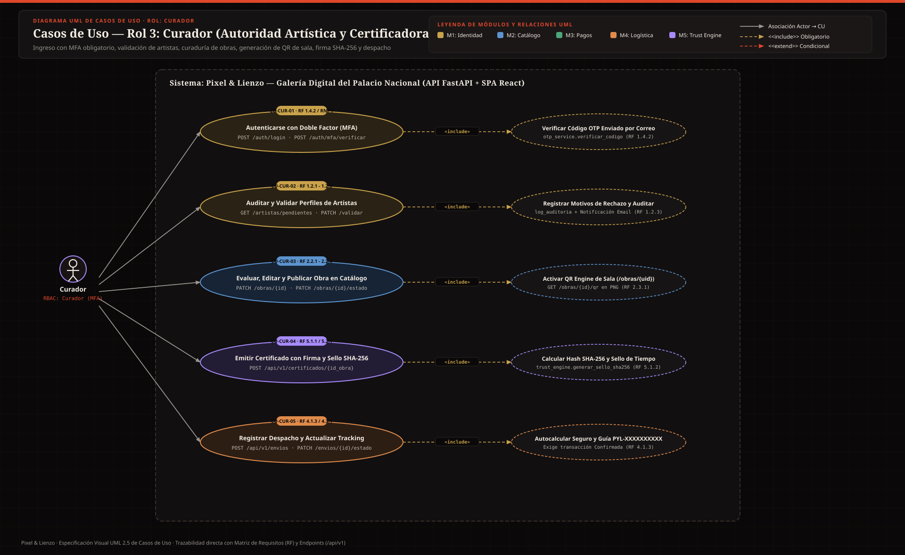
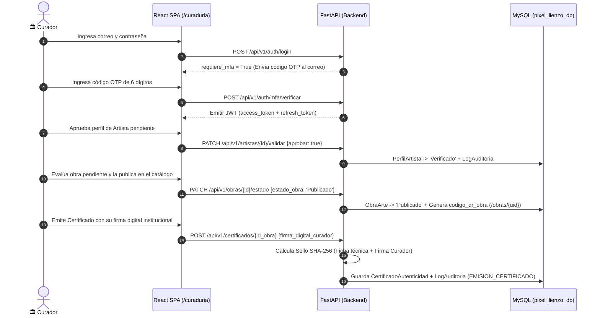

# 🏛️ Casos de Uso — Rol 3: Curador (`Curador`)

El **Curador** es la autoridad artística y técnica del Palacio Nacional. Audita y aprueba la vinculación de nuevos artistas, evalúa las obras postuladas, corrige metadatos técnicos, publica piezas en el catálogo generando su código QR de sala, emite los Certificados de Autenticidad con su firma digital (**Trust Engine**) y coordina el despacho logístico.

---

## 🖼️ Diagrama UML de Casos de Uso — Rol Curador (SVG)

---

## 🔄 Diagrama de Secuencia del Flujo Principal del Curador (MFA → Curaduría + QR → Firma SHA-256 → Despacho)

---

## CU-CUR-01: Autenticación con Doble Factor Obligatorio (MFA)
- **Actor Principal:** Curador
- **Requisitos Asociados:** `RF 1.4.1`, `RF 1.4.2`, `RNF 7`
- **Endpoints y Tablas:** `POST /api/v1/auth/login`, `POST /api/v1/auth/mfa/verificar` | Tablas: `usuario`, `rol`, `log_auditoria`
- **Precondiciones:** Cuenta de Curador creada por el Administrador (`estado_cuenta = 'Activo'`).
- **Flujo Principal:**
  1. El curador ingresa su correo y contraseña en `/login`.
  2. Por tratarse del rol `Curador` (`ROLES_CON_MFA_OBLIGATORIO`), el sistema **no entrega los tokens JWT en el primer paso**, sino que devuelve `requiere_mfa = True` y envía un código OTP de un solo uso al correo institucional del curador.
  3. El curador es redirigido a `/mfa`, ingresa el código OTP (`POST /auth/mfa/verificar`) y recibe sus tokens definitivos (`access_token` y `refresh_token`).
- **Postcondiciones:** Acceso autenticado con doble factor verificado antes de permitir cualquier firma curatorial.

---

## CU-CUR-02: Auditoría y Validación de Perfiles de Artistas
- **Actor Principal:** Curador
- **Requisitos Asociados:** `RF 1.2.1`, `RF 1.2.2`, `RF 1.2.3`, `RF 1.3.3`
- **Endpoints y Tablas:** `GET /api/v1/artistas/pendientes`, `PATCH /api/v1/artistas/{id_artista}/validar` | Tablas: `perfil_artista`, `log_auditoria`
- **Precondiciones:** Sesión activa con rol `Curador`.
- **Flujo Principal:**
  1. En el panel `/curaduria`, el curador consulta la bandeja de artistas con `estado_validacion = 'Pendiente'` (`GET /artistas/pendientes`).
  2. Revisa la `biografia_profesional` y el documento cargado en `documento_identidad_url` (sin tener acceso en ningún momento a `informacion_bancaria`, cumpliendo `RF 1.3.3`).
  3. Aprueba (`aprobar = True` → pasa a `'Verificado'`) o rechaza (`aprobar = False` indicando `motivos_rechazo` obligatorios → pasa a `'Rechazado'`).
  4. El sistema registra la decisión en `log_auditoria` (`VALIDACION_ARTISTA`) y envía un correo automático al artista notificándole el resultado y las observaciones.
- **Postcondiciones:** Artista habilitado para publicar obras o notificado con retroalimentación técnica.

---

## CU-CUR-03: Evaluación Curatorial, Edición Técnica y Publicación de Obra con QR
- **Actor Principal:** Curador
- **Requisitos Asociados:** `RF 2.2.1`–`2.2.4`, `RF 2.3.1`, `RF 2.3.2`, `RF 2.4.4`
- **Endpoints y Tablas:** `GET /api/v1/obras/pendientes`, `PATCH /api/v1/obras/{id_obra}`, `PATCH /api/v1/obras/{id_obra}/estado`, `GET /api/v1/obras/{id_obra}/qr` | Tablas: `obra_arte`, `log_auditoria`
- **Precondiciones:** Obra registrada en `estado_obra = 'Pendiente'`.
- **Flujo Principal:**
  1. El curador lista las obras pendientes de evaluación (`GET /obras/pendientes`).
  2. Si detecta errores tipográficos o de categorización en la ficha técnica, los corrige mediante `PATCH /obras/{id_obra}` (`RF 2.2.4`), quedando registro en `log_auditoria`.
  3. Evalúa la obra mediante `PATCH /obras/{id_obra}/estado`:
     - Si la aprueba (`estado_obra = 'Publicado'`), el sistema activa automáticamente el **QR Engine**, asignando a `codigo_qr_obra` la URL pública basada en su `uid` (`{FRONTEND_URL}/obras/{uid}`) y habilitando la descarga del QR en PNG (`GET /obras/{id_obra}/qr`).
     - Si la rechaza o cambia su disponibilidad de sala (`'En Préstamo'` / `'Mantenimiento'`, `RF 2.4.4`), registra el motivo correspondiente.
  4. El sistema guarda la decisión en `log_auditoria` (`VALIDACION_OBRA`) y notifica por correo al artista.
- **Postcondiciones:** Obra publicada en el catálogo comercial con código QR físico de sala listo para impresión.

---

## CU-CUR-04: Emisión de Certificado de Autenticidad con Firma Digital y Sello SHA-256
- **Actor Principal:** Curador
- **Requisitos Asociados:** `RF 1.5.2`, `RF 5.1.1`, `RF 5.1.2`, `RF 5.2.1`
- **Endpoints y Tablas:** `GET /api/v1/certificados/pendientes`, `POST /api/v1/certificados/{id_obra}`, `GET /api/v1/certificados/{id_obra}/qr` | Tablas: `certificado_autenticidad`, `obra_arte`, `log_auditoria`
- **Precondiciones:** La obra debe haber superado la revisión curatorial (`estado_obra != 'Pendiente'`) y no poseer un certificado previo.
- **Flujo Principal:**
  1. En `/curaduria`, el curador consulta las obras aprobadas pendientes de certificación (`GET /certificados/pendientes`).
  2. Abre el diálogo de emisión (`DialogoEmitirCertificado.tsx`), ingresa su `firma_digital_curador` y la referencia del documento `pdf_certificado_url`.
  3. El **Trust Engine** (`trust_engine.generar_sello_sha256`) calcula un hash criptográfico **SHA-256** único combinando los metadatos de la obra (`uid`, `titulo`, `tecnica`, `dimensiones`, `anio_creacion`, `id_artista`) y la firma del curador, estampando el `sello_tiempo` (`TIMESTAMP`).
  4. Se almacena el certificado y se registra de forma inmutable en `log_auditoria` (`EMISION_CERTIFICADO`).
- **Flujo Alternativo / Excepciones:**
  - *409 Conflict:* Si se intenta emitir un segundo certificado para la misma obra, el sistema lo rechaza (`"La obra ya posee un certificado"`).
- **Postcondiciones:** Obra respaldada por un sello criptográfico SHA-256 y QR de verificación pública.

---

## CU-CUR-05: Gestión de Despacho Logístico y Generación de Guía PYL
- **Actor Principal:** Curador (o Administrador)
- **Requisitos Asociados:** `RF 4.1.3`, `RF 4.2.3`, `RF 4.3.1`
- **Endpoints y Tablas:** `POST /api/v1/envios`, `GET /api/v1/envios`, `PATCH /api/v1/envios/{id_envio}/estado` | Tablas: `envio_logistica`, `transaccion`, `obra_arte`
- **Precondiciones:** Transacción de compra con `estado_pago = 'Confirmado'`.
- **Flujo Principal:**
  1. Tras recibir la notificación de venta confirmada, el curador registra el despacho en `POST /envios` indicando `id_transaccion`, `tipo_envio` (`Estándar` o `Express`) y `costo_envio`.
  2. El sistema autocalcula el `valor_seguro` por el total de la obra si no se especifica, genera el número de guía único `PYL-XXXXXXXXXX` en estado `'Empacado'` y notifica por correo al comprador.
  3. A medida que avanza el transporte (`En Camino`, `En Centro de Distribución`), actualiza el tracking en `PATCH /envios/{id_envio}/estado`, enviando notificaciones automáticas al comprador.
- **Postcondiciones:** Pieza en tránsito asegurada y monitoreada hasta la recepción del comprador.

