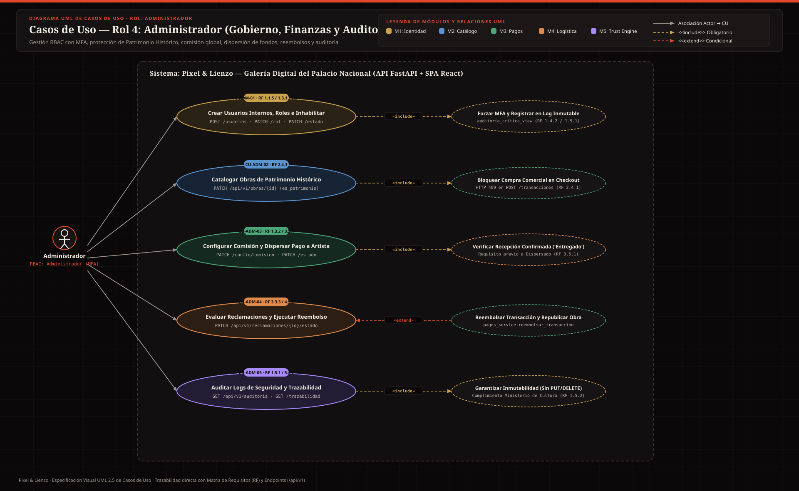
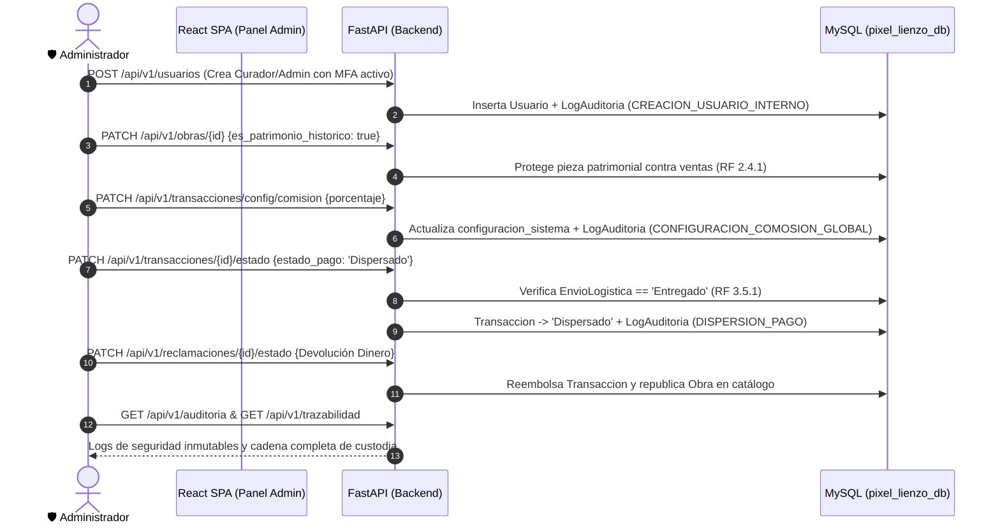

# 🛡️ Casos de Uso — Rol 4: Administrador (`Administrador`)

El **Administrador** es la máxima autoridad operativa, financiera y de seguridad de la plataforma **Pixel & Lienzo**. Gestiona usuarios internos y permisos (**RBAC**), protege las piezas de **Patrimonio Histórico**, administra el parámetro global de comisión de la galería, autoriza la dispersión de pagos a los artistas, resuelve reclamaciones con reembolso automático y audita los logs inmutables de seguridad y trazabilidad.

---

## 🖼️ Diagrama UML de Casos de Uso — Rol Administrador (SVG)

---

## 🔄 Diagrama de Secuencia del Flujo Principal del Administrador (RBAC → Comisión → Dispersión → Reembolso y Auditoría)

---

## CU-ADM-01: Creación de Usuarios Internos, Gestión de Roles e Inhabilitación de Cuentas
- **Actor Principal:** Administrador
- **Requisitos Asociados:** `RF 1.1.5`, `RF 1.3.1`, `RF 1.3.6`, `RF 1.3.7`, `RF 1.4.2`
- **Endpoints y Tablas:** `GET /api/v1/usuarios`, `POST /api/v1/usuarios`, `PATCH /api/v1/usuarios/{id}/rol`, `PATCH /api/v1/usuarios/{id}/estado` | Tablas: `usuario`, `rol`, `log_auditoria`
- **Precondiciones:** Sesión autenticada con rol `Administrador` y segundo factor MFA verificado (`POST /auth/mfa/verificar`).
- **Flujo Principal:**
  1. **Creación interna (`POST /usuarios`, `RF 1.1.5`):** El administrador crea cuentas para nuevos Curadores o Administradores asignando correo, contraseña inicial y rol, activando automáticamente `mfa_activado = True` y registrando `CREACION_USUARIO_INTERNO` en `log_auditoria`.
  2. **Cambio de rol (`PATCH /usuarios/{id}/rol`, `RF 1.3.1`):** Modifica el rol de un usuario existente, quedando trazabilidad en `log_auditoria` (`CAMBIO_ROL_USUARIO`).
  3. **Inhabilitación inmediata (`PATCH /usuarios/{id}/estado`, `RF 1.3.7`):** Ante infracciones o inconsistencias documentales, cambia `estado_cuenta` a `'Inhabilitado'`. Cualquier petición subsiguiente de ese usuario es rechazada de inmediato por `get_current_user` y el evento queda registrado en `auditoria_critica_view` (`INHABILITACION_CUENTA`).
- **Postcondiciones:** Gobierno de identidades y control de acceso actualizado con trazabilidad perimetral.

---

## CU-ADM-02: Catalogación y Protección de Piezas de Patrimonio Histórico
- **Actor Principal:** Administrador
- **Requisitos Asociados:** `RF 2.4.1`
- **Endpoints y Tablas:** `PATCH /api/v1/obras/{id_obra}` | Tablas: `obra_arte`, `log_auditoria`
- **Precondiciones:** Sesión activa con rol `Administrador`.
- **Flujo Principal:**
  1. El administrador identifica una obra perteneciente al acervo patrimonial del Palacio Nacional y actualiza su atributo `es_patrimonio_historico = True` mediante `PATCH /obras/{id_obra}` (campo restringido exclusivamente al rol `Administrador`).
  2. La obra permanece visible en el catálogo cultural y mediante su QR de sala, pero el Motor de Pago (`POST /transacciones`) bloquea cualquier intento de compra sobre ella con `HTTP 409 Conflict`.
- **Postcondiciones:** Pieza patrimonial protegida contra transacciones comerciales.

---

## CU-ADM-03: Configuración de Comisión Global, Liberación de Reservas y Dispersión de Fondos
- **Actor Principal:** Administrador
- **Requisitos Asociados:** `RF 1.3.2`, `RF 3.2.1`, `RF 3.2.3`, `RF 3.5.1`, `RF 3.5.2`, `RF 3.5.3`
- **Endpoints y Tablas:** `GET /api/v1/transacciones/config/comision`, `PATCH /api/v1/transacciones/config/comision`, `GET /api/v1/transacciones`, `PATCH /api/v1/transacciones/{id}/estado`, `POST /api/v1/transacciones/liberar-vencidas` | Tablas: `configuracion_sistema`, `transaccion`, `envio_logistica`, `log_auditoria`
- **Precondiciones:** Sesión activa con rol `Administrador`.
- **Flujo Principal:**
  1. **Ajuste de comisión (`PATCH /transacciones/config/comision`):** El administrador actualiza el porcentaje de comisión de la galería en la tabla persistente `configuracion_sistema`. El cambio registra `actualizado_por` y escribe en `log_auditoria` (`CONFIGURACION_COMOSION_GLOBAL`).
  2. **Monitoreo de ventas (`GET /transacciones`):** Visualiza todas las transacciones del sistema con su desglose financiero (`monto_total`, `monto_comision_galeria`, `monto_neto_artista`).
  3. **Dispersión de fondos al artista (`PATCH /transacciones/{id}/estado` → `'Dispersado'`):** Una vez verificado que el envío asociado tiene `estado_envio = 'Entregado'` (`RF 3.5.1`), el administrador autoriza la dispersión del pago neto al artista. El sistema envía la notificación de depósito al artista (`RF 3.5.3`) y registra `DISPERSION_PAGO` en `log_auditoria`.
- **Flujo Alternativo / Excepciones:**
  - *409 Conflict:* Si el administrador intenta dispersar fondos de una obra cuyo envío aún no está `'Entregado'`, el sistema bloquea la operación para proteger la garantía del comprador.
- **Postcondiciones:** Liquidación financiera ejecutada y auditada.

---

## CU-ADM-04: Evaluación de Reclamaciones y Ejecución de Reembolso Automático
- **Actor Principal:** Administrador
- **Requisitos Asociados:** `RF 3.3.3`, `RF 4.5.2`
- **Endpoints y Tablas:** `GET /api/v1/reclamaciones`, `GET /api/v1/reclamaciones/{id}`, `PATCH /api/v1/reclamaciones/{id}/estado` | Tablas: `reclamacion`, `transaccion`, `obra_arte`, `log_auditoria`
- **Precondiciones:** Existencia de una reclamación registrada por un comprador sobre un envío.
- **Flujo Principal:**
  1. El administrador consulta las reclamaciones abiertas (`GET /reclamaciones`) y revisa la descripción del daño y las fotografías de evidencia (`evidencias_fotos_url`).
  2. Emite su resolución mediante `PATCH /reclamaciones/{id}/estado` eligiendo entre:
     - `'Aprobado Seguro'`: Activa la póliza de transporte por el `valor_seguro`.
     - `'Devolución Dinero'`: Dispara automáticamente el servicio `pagos_service.reembolsar_transaccion`, pasando la transacción a `'Reembolsado'` y devolviendo la obra a `'Publicado'`.
     - `'Rechazado'`: Cierra la reclamación por falta de mérito en la evidencia.
  3. El sistema notifica por correo al comprador y registra `RESOLUCION_RECLAMACION` en `log_auditoria`.
- **Postcondiciones:** Incidencia logística resuelta con sincronización automática de inventario y estado financiero.

---

## CU-ADM-05: Auditoría Inmutable de Seguridad y Consulta Global de Trazabilidad
- **Actor Principal:** Administrador
- **Requisitos Asociados:** `RF 1.4.5`, `RF 1.5.1`, `RF 1.5.2`, `RF 1.5.3`, `RF 5.4.2`, `RNF 8`
- **Endpoints y Tablas:** `GET /api/v1/auditoria`, `GET /api/v1/trazabilidad` | Tablas: `log_auditoria`, `historial_trazabilidad`, vista `auditoria_critica_view`
- **Precondiciones:** Sesión activa con rol `Administrador`.
- **Flujo Principal:**
  1. El administrador consulta `GET /auditoria` para inspeccionar cronológicamente todos los eventos críticos de seguridad: inicios de sesión fallidos, creación de usuarios internos, cambios de rol, inhabilitaciones de cuentas, validaciones curatoriales, emisión de certificados, cambios de comisión y dispersiones de pago.
  2. Consulta `GET /trazabilidad` (`RF 5.4.2`) para verificar la cadena completa de custodia y cambios de propiedad (*Provenance*) de todas las obras comercializadas en la galería.
- **Regla de Integridad (`RF 1.5.2`):** No existe en la API ningún endpoint `PUT`, `PATCH` ni `DELETE` sobre `log_auditoria` ni `historial_trazabilidad`, garantizando su inmutabilidad.
- **Postcondiciones:** Evidencia técnica e institucional disponible para auditorías del Palacio Nacional y Ministerio de Cultura.

